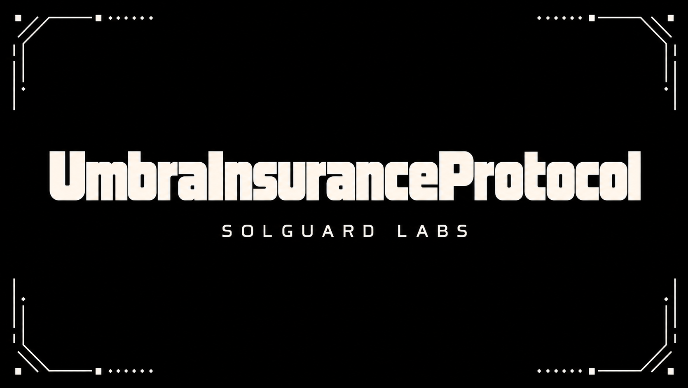
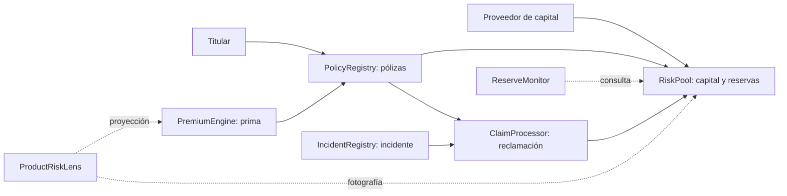

# Umbra Insurance Protocol



Umbra Insurance Protocol organiza coberturas para pérdidas en bóvedas. Los titulares
contratan pólizas sobre un producto y una bóveda concretos; los proveedores de capital
aportan recursos a pools de riesgo que respaldan esas obligaciones.

El sistema separa custodia, cálculo de primas, emisión, incidentes, reclamaciones y
monitorización. Las lecturas de riesgo son informativas; la admisión y liquidación se
validan de nuevo en las transacciones correspondientes.



Consulta [docs/](./docs/README.md) para el modelo de capital, las rutas de integración
y los procedimientos operativos.

## Componentes

| Componente | Responsabilidad |
| --- | --- |
| `RiskPool` | Custodia capital de underwriters, reservas de polizas, retiradas y pagos de claims. |
| `PremiumEngine` | Calcula primas segun producto, duracion, cobertura y utilizacion del pool. |
| `PolicyRegistry` | Emite polizas tokenizadas, reserva cobertura y gestiona expiracion. |
| `IncidentRegistry` | Registra incidentes aprobados para productos y vaults cubiertos. |
| `ClaimProcessor` | Recibe claims y coordina su revision y pago por lotes. |
| `ClaimReviewBoard` | Coordina revisiones operativas y recomendaciones sobre claims. |
| `ReserveMonitor` | Expone vistas agregadas de solvencia y presion de claims. |
| `ProductRiskLens` | Proyecta capital, reservas y utilización de una nueva cobertura sin modificar estado. |
| `RiskOracle` | Mantiene senales operativas de riesgo para reporting y pricing externo. |
| `EpochAccounting` | Guarda snapshots de pools por epoca para revision operacional. |
| `CoverageTerms` | Versiona documentos de condiciones de cobertura. |
| `TreasuryRouter` | Contabiliza fees y presupuestos operativos por categoria. |

## Flujos principales

1. Un underwriter deposita capital en `RiskPool` y recibe shares internas.
2. Gobernanza configura un producto en `PremiumEngine`.
3. Un usuario compra una poliza en `PolicyRegistry`.
4. El pool recibe la prima de reserva y bloquea capacidad para la cobertura.
5. Un keeper abre un incidente en `IncidentRegistry`.
6. El beneficiario presenta un claim en `ClaimProcessor`.
7. Un keeper procesa el lote de claims y el pool realiza los pagos aprobados.
8. Las polizas expiradas liberan reserva y los underwriters pueden retirar capital disponible.

## Modelo económico resumido

Para capital contable `C`, reservas de pólizas `R` y retiradas pendientes `W`, la
capacidad disponible se muestra como `max(C − R − W, 0)`. La utilización es
`R / C`, expresada en puntos básicos. La prima combina una tasa base, un recargo
dependiente de la utilización proyectada y la duración de la cobertura; se
separa en aportación al pool y comisión de protocolo. El pago de una reclamación
se limita por cobertura, pérdida demostrada y deducible aplicable.

La fórmula describe el estado contable, no una garantía de liquidez futura.
La [documentación económica](./docs/modelo-economico.md) detalla unidades,
redondeos y escenarios de estrés.

## Requisitos

- Foundry estable (`forge`, `cast`, `anvil`).
- Git.
- Solidity `0.8.26`.

## Instalación

```bash
git clone https://github.com/SolguardLabs/UmbraInsuranceProtocol.git
cd UmbraInsuranceProtocol
bash scripts/bootstrap.sh
forge build
```

Si el repositorio ya incluye `lib/forge-std`, no hace falta reinstalar dependencias.

## Validación

```bash
# Pruebas y CI
bash scripts/tests.sh
bash scripts/ci.sh
```

En Windows, si Bash no puede ejecutar el binario de Foundry, utiliza PowerShell
para `forge fmt --check`, `forge build --sizes` y `forge test`. Los scripts de
Bash son la entrada canónica de CI.

`ProductRiskLens.project(productId, cobertura, duración)` devuelve la cotización
y el efecto proyectado sobre capital, reservas, disponibilidad y utilización.
No reserva capacidad ni mantiene una cotización vigente; la compra recalcula el
estado en el bloque de ejecución.

## Despliegue de referencia

`script/DeployUmbra.s.sol` despliega los modulos principales, conecta permisos entre ellos y
crea un producto inicial. Ejemplo de simulacion:

```bash
PRIVATE_KEY=<clave-local> \
UMBRA_ASSET=<erc20> \
UMBRA_TREASURY=<tesoreria> \
forge script script/DeployUmbra.s.sol:DeployUmbra --rpc-url <rpc> -vvvv
```

Para emitir transacciones se añade `--broadcast` únicamente en un entorno
controlado. La publicación de una versión del código no despliega contratos.
Las variables `UMBRA_*` ajustan capital mínimo, utilización, duraciones y
parámetros de producto. Nunca guardes claves en el repositorio.

## Estructura

```text
.
├── src/
│   ├── core/          # Pools, pricing, polizas, incidentes, claims y monitores
│   ├── interfaces/    # Interfaces publicas
│   ├── libraries/     # Matematicas, transferencias, hashes y formulas de seguro
│   ├── security/      # Roles y proteccion contra reentrada
│   ├── token/         # Tokens de recibo y poliza
│   └── types/         # Structs, enums y constantes compartidas
├── docs/              # Arquitectura, economía, integración, operaciones y riesgos
├── test/              # Pruebas Foundry
├── script/            # Despliegue
├── scripts/           # Comandos locales y CI
└── foundry.toml       # Configuracion de Foundry
```

## Desarrollo Seguro

Los cambios que afecten a capital, reservas, claims, expiraciones o permisos deben incluir
pruebas de conservacion de saldos y casos de borde. Los reportes de seguridad deben seguir
el proceso descrito en [SECURITY.md](SECURITY.md).

## Licencia

MIT. Consulte [LICENSE](LICENSE).
