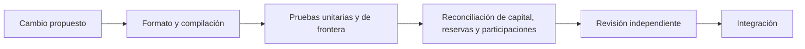

# Política de seguridad

UmbraInsuranceProtocol administra capital compartido y obligaciones de cobertura. Cualquier
cambio debe tratar los saldos, reservas y claims como contabilidad critica.

## Modelo de Seguridad

- Los underwriters solo deben poder retirar capital disponible.
- Las polizas activas deben mantener una reserva economica coherente con su cobertura.
- Los incidentes deben coincidir con producto, vault cubierto y ventana temporal de la poliza.
- Los claims solo deben ser presentados por titulares o beneficiarios autorizados.
- Los pagos deben respetar cobertura, deducible, estado de poliza y capital de pool.
- Los roles de gobernanza, guardian y keeper deben ser rotables y minimizados.

## Invariantes Esperadas

- `totalCapital` debe reconciliar con depositos, primas, pagos, fees y retiradas.
- `reservedCapital` debe representar obligaciones vivas o pendientes de cierre.
- `availableCapital` no debe incluir reservas ni retiradas pendientes.
- Una poliza no debe poder reclamarse mas de una vez.
- Un incidente archivado no debe admitir nuevos claims.
- Las retiradas pendientes no deben interferir con reservas activas.
- La emisión y valoración de participaciones deben mantener una relación
  coherente con el capital atribuible y las obligaciones pendientes.

## Validacion

La suite publica cubre:

- compra y reserva de polizas;
- expiracion y liberacion de reserva;
- apertura de incidentes;
- claims individuales y por lote;
- retiradas diferidas de capital;
- vistas de monitorizacion.
- proyecciones de producto sin efectos de estado.



Las pruebas automatizadas no equivalen a una auditoría independiente. Las
proyecciones de lectura no conceden derechos sobre capital ni sustituyen los
controles de la operación transaccional.

Comandos recomendados:

```bash
forge fmt --check
forge build --sizes
forge test -vvv
FOUNDRY_PROFILE=ci forge test -vvv
```

## Gestion de Dependencias

El repositorio usa Foundry y `forge-std`. Dependabot revisa GitHub Actions. Antes de
actualizar toolchains o remappings, ejecute la suite completa y revise cambios en bytecode.

## Alcance de Revision

Entran en alcance:

- contratos en `src/`;
- scripts de despliegue;
- pruebas de integracion;
- configuracion de Foundry y CI.

Fuera de alcance:

- despliegues externos no reproducibles;
- tokens ERC20 no estandar no incluidos como mocks;
- integraciones off-chain no presentes en este repositorio.

## Reporte

Para reportes internos incluya:

- descripcion tecnica;
- precondiciones;
- impacto economico;
- reproduccion minima;
- contratos y funciones afectadas;
- mitigacion propuesta;
- tests recomendados.

No publique detalles sensibles en issues publicas.

