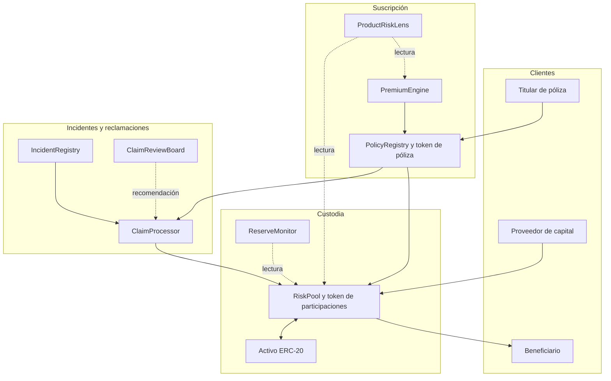

# Arquitectura y límites de confianza

Umbra separa los movimientos de activos de las decisiones de cobertura. `RiskPool`
custodia el activo, mantiene capital y reservas, emite participaciones y liquida
retiradas. `PremiumEngine` configura productos y calcula primas. `PolicyRegistry`
compra y tokeniza pólizas, mientras `IncidentRegistry` conserva los eventos
elegibles y `ClaimProcessor` coordina su evaluación y pago.

El propietario de una póliza NFT y el beneficiario son conceptos distintos: la
titularidad controla su administración; el beneficiario designa a quién puede
dirigirse una indemnización. Las aprobaciones de los tokens no sustituyen las
validaciones del procesador de reclamaciones.

## Fronteras operativas

- Gobernanza configura pools y productos y conecta módulos autorizados.
- Guardian puede cerrar admisión; no debe reabrir un pool por sí solo.
- Keeper registra incidentes y procesa lotes según los permisos configurados.
- Los proveedores y titulares actúan a través de contratos públicos sin permisos
  administrativos.
- `ReserveMonitor` y `ProductRiskLens` solo consultan. No custodian fondos ni
  aprueban reclamaciones.

Cada llamada de compra y liquidación recalcula las condiciones sobre el estado
de su transacción. El orden de las operaciones dentro de un bloque puede cambiar
capital, reservas y capacidad respecto de una lectura previa.
