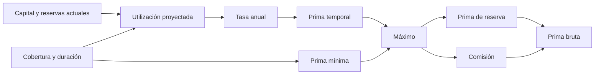

# Modelo económico

Sea `C` el capital contable del pool, `R` la reserva de coberturas activas y
`W` el nominal de retiradas pendientes. La capacidad visible es
`A = max(C − R − W, 0)`. La utilización se expresa en puntos básicos:
`U = floor(10_000 × R / C)`, con cero cuando `C = 0`. La configuración del pool
limita la utilización admitida tras cada nueva póliza.

## Prima de una cobertura

Para cobertura `K`, duración `T` en segundos, tasa base `b`, pendiente de
utilización `s` y comisión `f`, el motor calcula:

```text
U_proyectada = min(10_000, floor(10_000 × (R + K) / C))
tasa_variable = ceil(s × U_proyectada / 10_000)
tasa_anual = b + tasa_variable
prima_temporal = ceil(K × tasa_anual × T / (10_000 × 365 días))
prima_suelo = ceil(K × (floor(b / 4) + 1) / 10_000)
prima_pool = max(prima_temporal, prima_suelo)
comisión_protocolo = ceil(prima_pool × f / 10_000)
prima_bruta = prima_pool + comisión_protocolo
```

La prima del pool incrementa `C`; la comisión se dirige a tesorería. La reserva
incrementa `R` por el nominal completo de cobertura, con independencia del
deducible. En un pool con `C = 1.000`, `R = 0`, cobertura `K = 100`, duración
30 días, `b = 300`, `s = 900` y `f = 500` puntos básicos, la utilización
proyectada es 1.000 puntos básicos y la tasa anual es 390. La prima temporal
aproximada es 0,321; el suelo de 0,76 domina, y la prima bruta aproximada es
0,798 unidades. Los resultados exactos dependen de las unidades mínimas y
del redondeo hacia arriba en cada paso.



## Reclamaciones y capital

El cálculo de una pérdida cubierta usa `min(cobertura, pérdida solicitada)`.
El deducible es un porcentaje de esa pérdida cubierta, redondeado hacia arriba;
la indemnización propuesta es la diferencia. Con cobertura 100, pérdida 100
y deducible del 10 %, el pago propuesto es 90. El procesador exige además
incidente, producto, bóveda, estado de póliza y permisos consistentes.

Los pagos reducen capital; al cerrar una póliza reclamada o expirada, la
reserva correspondiente deja de respaldar esa cobertura. Las participaciones
de los proveedores representan una fracción del capital contabilizado, no una
promesa de rendimiento fijo. El valor puede variar con primas, indemnizaciones
y retiradas; las vistas previas no garantizan el resultado de una operación
futura.
