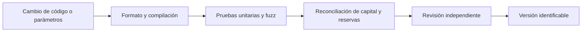

# Operaciones y calidad

## Preparación de entornos

La versión de Solidity se fija en `0.8.26`. `scripts/bootstrap.sh` instala
`forge-std` en una versión concreta cuando no está disponible. El entorno
debe registrar direcciones de módulos, producto, activo, parámetros de pool
y administrador antes de admitir operaciones. El script de despliegue puede
simularse sin `--broadcast`; crear una versión en GitHub no implica emitir
transacciones ni activar un servicio externo.

Las claves privadas pertenecen a un sistema de secretos del entorno y no a
archivos versionados o logs. Tras desplegar, comprobar que `RiskPool` conoce
las direcciones autorizadas de registro y procesador, y que sus permisos
corresponden a las funciones previstas.

## Puertas de cambio

`bash scripts/ci.sh` ejecuta formato, compilación y tests con el perfil de CI.
Para cambios en cálculos, cubrir cero, límites de utilización, redondeos,
duraciones mínima y máxima y combinaciones de reservas y retiradas pendientes.
La comparación entre `main`, la rama `production` y el tag es un control de
identidad del código publicado; no valida por sí sola un despliegue on-chain.

## Observabilidad

Registrar por pool depósitos, primas, reservas, reclamaciones, retiradas
solicitadas/ejecutadas y cambios de admisión. Alertar sobre utilización alta,
reducción rápida de capital, acumulación de reclamaciones y discrepancias
entre balances de activo y contabilidad. Una alerta requiere diagnóstico;
las vistas agregadas por sí solas no justifican movimientos automáticos de
tesorería o cambios de producto.
