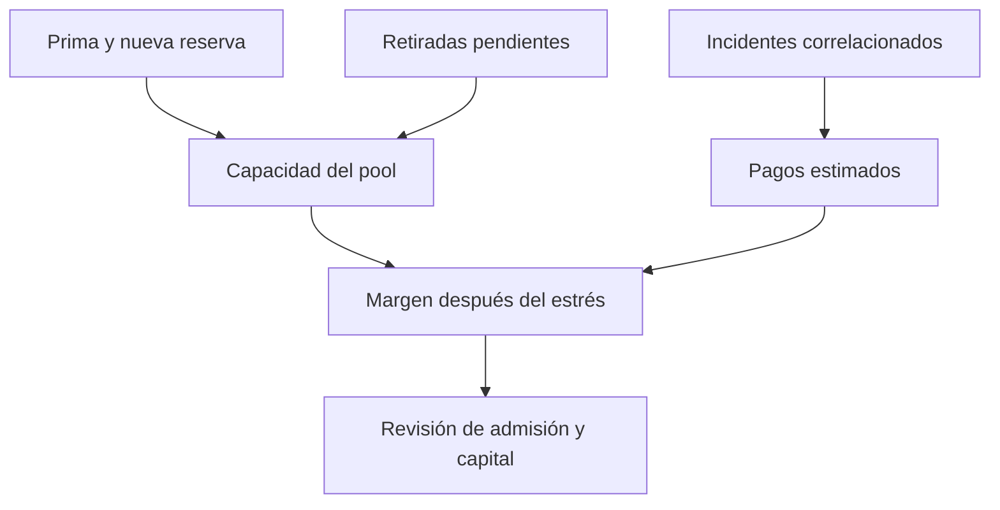

# Riesgos y supuestos

## Exposición económica

El capital de proveedores absorbe indemnizaciones aprobadas. La cobertura
nominal reservada no determina por sí sola el pago: deducible, pérdida
documentada e incidente elegible intervienen en el cálculo. Las primas
incrementan la capacidad contable, pero no sustituyen capital suficiente
para escenarios correlacionados entre bóvedas o productos.

Una revisión de estrés debe considerar varios incidentes simultáneos,
concentración por bóveda, retiradas en espera y cambios de utilización. Como
medida informativa, para pérdidas agregadas hipotéticas `L` puede observarse
`C_estrés = max(C − L, 0)` y compararlo con reservas restantes. El orden de
liquidación y liberación de reservas importa; el indicador no es una
preautorización para procesar reclamaciones.

## Dependencias y límites

Las pruebas usan un ERC-20 estándar. Tokens con comisiones de transferencia,
rebases, callbacks arbitrarios o retornos atípicos requieren evaluación
específica. La integridad de un hash de evidencia no demuestra por sí sola la
veracidad de su contenido. Los roles de keeper y gobernanza deben estar
protegidos operativamente; sus decisiones afectan la elegibilidad y el
tratamiento de reclamaciones.

## Revisión recomendada

Reconciliar por pool el capital registrado con movimientos reales, reservas
vivas, retiradas pendientes y participaciones en circulación. Las pruebas
deben cubrir secuencias de varias operaciones, no únicamente funciones
aisladas: entrada y salida de proveedores, compra de pólizas, primas, claims,
expiraciones y cierre de tickets. Una comprobación local no equivale a una
auditoría ni a la validación de parámetros de un entorno externo.
